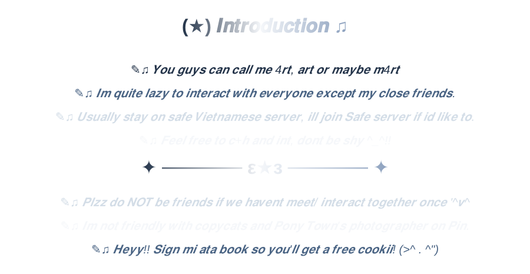
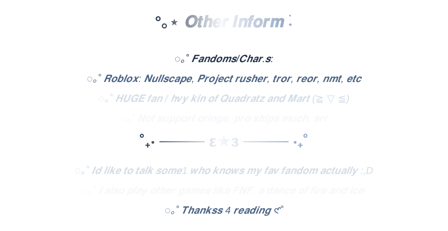

 

  

  

  

<table>
  <td width="650" align="center">
    

      
    

  </td>
  <td width="280" align="center">
    
  </td>

</table>

 

 

<table>
  <td width="280" align="center">
    
  </td>
  
  <td width="650" align="center">
    

      
    

  </td>
</table>

 

  

$\color{#ffffff}{\text{This assist name Rayvelline "Rae". Gauge:}}$ $\color{#a31d10}{\text{GLUIT}}$ 

$\color{#ffffff}{\text{To get this assist, you have to beat Iris (playlist 1A) as Iris, Surreal (playlist 1B) as Lester and Ziera (lots of Ziera songs after playing those 2 songs)}}$

$\color{#ffffff}{\text{as any character then youll get kicked by its moderator with the message: "." . Rejoin again, pick any dificulty u want, }}$

$\color{#ffffff}{\text{open the door and beat INTENTIONS to get Rae! }}$
